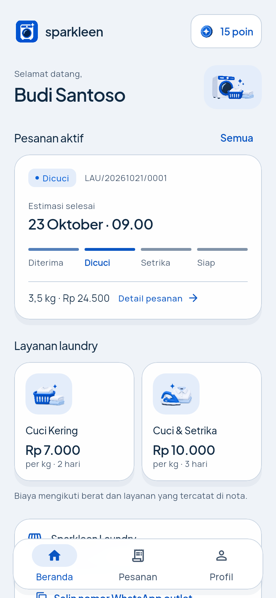
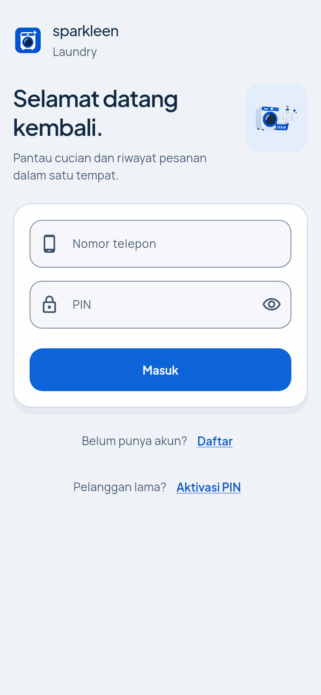
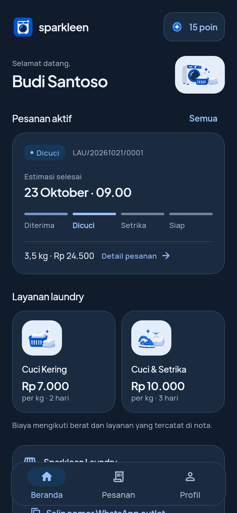

# Sparkleen App

Aplikasi pelanggan Sparkleen Laundry. Dibangun dengan Flutter dan terhubung ke REST API
`/api/v1` milik backend CodeIgniter 4 Sparkleen (repo terpisah).

| Beranda | Masuk | Beranda (mode gelap) |
| --- | --- | --- |
|  |  |  |

> Tangkapan layar memakai data demo, bukan data pelanggan sungguhan.

## Fitur

- Masuk dengan nomor telepon + PIN, daftar akun baru, dan aktivasi pelanggan lama lewat nomor nota.
- Beranda: sapaan, pesanan aktif, katalog layanan + harga, poin, dan kontak outlet.
- Riwayat pesanan dengan filter Aktif / Selesai / Semua serta pagination.
- Detail pesanan: timeline status, rincian layanan, pembayaran, dan PIN pengambilan.
- Nota digital yang tidak memuat PIN pengambilan.
- Profil, ubah nama/alamat, dan keluar akun.
- Tema terang/gelap dengan background solid, kaca padat, kontras teks dan batas
  input yang jelas, serta layout yang mengikuti pembesaran teks — tanpa gradasi.
- Kontrol visibilitas PIN, ringkasan layanan, dan tautan poin menuju profil.
- Sembilan aset visual Sparkleen: logo bersama, ilustrasi beranda/login, gambar
  layanan, kondisi pesanan kosong, gangguan koneksi, dan badge poin.
- Ikon launcher Android/adaptive icon, splash native Android, serta ikon PWA
  dan favicon memakai identitas Sparkleen.

## Kebutuhan

- Flutter dengan Dart 3.13.5+ (diverifikasi pada Flutter 3.47.9 / Dart 3.13.7).
- Android SDK untuk build APK.
- Backend Sparkleen `/api/v1` yang berjalan.
- Chrome opsional untuk menjalankan target web.

## Menjalankan

```bash
git clone https://github.com/rachmatx/sparkleen-app.git
cd sparkleen-app
flutter pub get
flutter run --dart-define=API_BASE_URL=http://10.0.2.2:8080
```

Pilihan `API_BASE_URL`:

| Target | Nilai |
| --- | --- |
| Emulator Android + backend lokal | `http://10.0.2.2:8080` (default) |
| Device fisik + backend LAN | `http://<IP-LAN-komputer>:8080` |
| Backend produksi | `https://<domain-backend>` |
| Chrome + backend lokal | `http://localhost:8080` (backend harus mengizinkan CORS) |

Tanpa `--dart-define`, aplikasi memakai `http://10.0.2.2:8080`. Untuk device fisik,
pastikan ponsel dan komputer berada di jaringan yang sama. Koneksi HTTP polos ke IP lokal
diizinkan lewat `android/app/src/debug/AndroidManifest.xml`; build release sebaiknya
memakai HTTPS.

### Variasi shell

CMD (Command Prompt):

```bat
set "API_URL=https://<domain-backend>"
flutter run --dart-define=API_BASE_URL=%API_URL%
```

PowerShell:

```powershell
$env:API_URL = "https://<domain-backend>"
flutter run --dart-define=API_BASE_URL=$env:API_URL
```

Git Bash:

```bash
export API_URL="https://<domain-backend>"
flutter run --dart-define=API_BASE_URL="$API_URL"
```

Linux / macOS:

```bash
export API_URL="https://<domain-backend>"
flutter run --dart-define=API_BASE_URL="$API_URL"
```

## Build

APK debug:

```bash
flutter build apk --debug --flavor preview --dart-define=APP_PREVIEW=true --dart-define=API_BASE_URL=http://10.0.2.2:8080
```

APK pratinjau release yang lebih kecil untuk HP Android ARM64 (termasuk Xiaomi 14T):

```bash
flutter pub get
flutter build apk --release --flavor preview --dart-define=APP_PREVIEW=true --target-platform=android-arm64 --split-per-abi --split-debug-info=build/symbols/0.0.4
```

Hasilnya `build/app/outputs/flutter-apk/app-arm64-v8a-preview-release.apk`.
Server dapat diatur dari gear login atau Profil → Pengaturan → Konfigurasi server.
Build preview mendukung HTTP lokal; HP dan laptop harus dapat saling terhubung.
Untuk mendistribusikan ke arsitektur lain, hapus `--target-platform=android-arm64`
dan tetap gunakan `--split-per-abi` agar setiap APK hanya memuat satu arsitektur.
Simpan direktori simbol bersama versi APK bila diperlukan untuk membaca crash trace.

Build produksi memakai flavor `production`, HTTPS, dan keystore milik pemilik aplikasi.
Guard build akan menolak production release sebelum konfigurasi signing disiapkan.

Hasil build ada di `build/app/outputs/flutter-apk/`. Konfigurasi signing release masih
memakai debug key bawaan template; buat `android/key.properties` dan konfigurasi keystore
sendiri sebelum distribusi produksi. File tersebut sudah diabaikan Git.

Build web:

```bash
flutter build web --release --dart-define=API_BASE_URL=https://<domain-backend>
```

## Analisis dan test

```bash
flutter analyze
flutter test
```

Hasil verifikasi terbaru, perubahan UI, dan batas pengujian Android dicatat dalam
[catatan 0.0.4](docs/redesign-v0.0.4.md). Jalankan pengujian di atas setelah mengubah kode.

## Struktur

```
lib/
  core/       tema, api client, secure storage token, router, widget bersama, formatter
  features/
    auth/     login, register, aktivasi, state auth
    home/     beranda, layanan, outlet
    pesanan/  riwayat, detail, timeline
    nota/     nota digital
    profil/   profil dan edit data
    splash/   layar awal
```

## Desain UI

- Palet solid: royal blue `#0D63D8`, teks `#102A43`, tint `#E4EDFA`, canvas terang `#EFF3F8` dan gelap `#101C2C`; tanpa gradasi.
- `AppCard` memakai `BackdropFilter` + border tipis untuk efek kaca.
- `AppBackdrop` memakai satu warna solid per tema; `AppCard` memakai opacity 95–96% dan dock 98%.
- `TicketDivider` memberi pemisah bergaya struk laundry.
- Tipografi Plus Jakarta Sans (judul) dan Manrope (isi).
- Warna, radius, dan shadow terpusat di `lib/core/theme/`.
- Artwork transparan memakai panel pale blue pada area ilustrasi agar tampil
  konsisten di kedua tema; gambar sumber tidak dimodifikasi.
- Detail pemetaan layanan, fallback, dan regenerasi ikon tersedia di
  [`docs/visual-assets.md`](docs/visual-assets.md).

## Keamanan

- Token hanya disimpan di secure storage dan tidak pernah ditulis ke log.
- PIN pengambilan hanya tampil di detail pesanan; payload nota tidak memuat PIN.
- Respons `401` menghapus token dan mengembalikan pengguna ke halaman masuk.
- Nominal pembayaran tidak pernah dikirim dari klien.
- File environment dan keystore diabaikan Git.

## Dokumen

- Integrasi aset: [`docs/visual-assets.md`](docs/visual-assets.md)
- Redesign UI/UX dan hasil verifikasi: [`docs/ui-ux-implementation.md`](docs/ui-ux-implementation.md)
- Spesifikasi: [`docs/superpowers/specs/2026-10-23-sparkleen-mobile-api-design.md`](docs/superpowers/specs/2026-10-23-sparkleen-mobile-api-design.md)
- Plan Flutter fase 1: [`docs/superpowers/plans/2026-10-24-sparkleen-mobile-flutter-phase1.md`](docs/superpowers/plans/2026-10-24-sparkleen-mobile-flutter-phase1.md)
- Plan backend fase 1: [`docs/superpowers/plans/2026-10-23-sparkleen-mobile-api-backend.md`](docs/superpowers/plans/2026-10-23-sparkleen-mobile-api-backend.md)
- Kontrak API: [`docs/api/sparkleen-mobile-v1.md`](docs/api/sparkleen-mobile-v1.md)
- Postman: [`docs/api/sparkleen-mobile-v1.postman_collection.json`](docs/api/sparkleen-mobile-v1.postman_collection.json)

## Status

Fase 1 selesai, redesign UI/UX dengan background solid, kaca padat, dan paket aset Sparkleen sudah diterapkan pada
layar terkait. Seluruh layar utama terhubung ke API, `flutter analyze` bersih,
dan `flutter test` hijau (94 test). Hasil render dan batas verifikasi ada di dokumen redesign.

## Integrasi backend pelanggan

API pelanggan membutuhkan branch backend `feat/customer-api-foundation` atau versi
yang sudah memuat 11 endpoint inti `/api/v1`. Hasil pengujian lokal dan batas
penerapannya dicatat di [integration-foundation-results](docs/integration-foundation-results.md).
Endpoint jemput tersedia pada `feat/pickup-requests`; endpoint pembayaran pelanggan masih rencana tahap berikutnya.

Uji eksplisit dengan backend dan database test lokal:

```sh
CI=true flutter test tool/customer_api_integration_test.dart --dart-define=API_BASE_URL=http://127.0.0.1:42525
```

Siapkan fixture backend terlebih dahulu dan set `LAUNDRY_TEST_ROOT` serta
`TEST_PHP_BIN` sesuai petunjuk backend. Uji ini memakai HTTP sungguhan dan
database `laundry_db_test`; suite widget biasa tetap memakai isolasi HTTP.

Verifikasi Android fisik dan syarat APK produksi:
[Android verification](docs/release/android-verification.md).

Permintaan jemput dari beranda dan alur antrean kasir:
[Pickup requests](docs/pickup-requests.md).


### UI refresh 0.0.2

Tema terang/gelap, panel glass, aset WebP, Pengaturan, serta perbaikan navigasi dan pemuatan riwayat: [catatan implementasi](docs/redesign-v0.0.2.md).


### Penyempurnaan UI 0.0.3

Notifikasi dengan “Hari ini” di kiri dan “Tandai semua dibaca” di kanan,
form berlabel tetap, layar keamanan/koneksi, serta koreksi nominal pembayaran lunas:
[catatan perubahan dan pengujian](docs/redesign-v0.0.3.md).


### Penyelarasan preview 0.0.4

Seluruh UI utama diselaraskan kembali dengan preview yang disetujui. Font Inter dibundel,
semua panel glass memakai opacity 75%, halaman koneksi menggunakan ilustrasi router,
dan splash minimal dua detik. [Rincian dan screenshot hasil kode](docs/redesign-v0.0.4.md).
