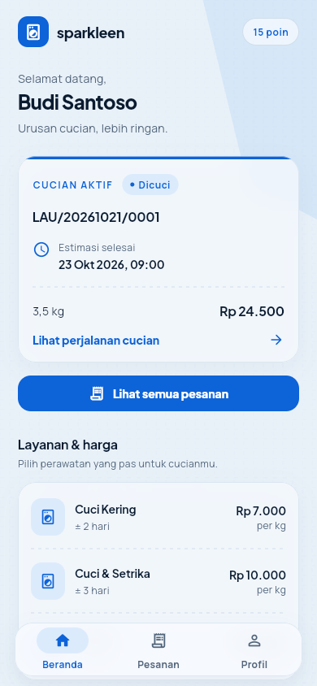
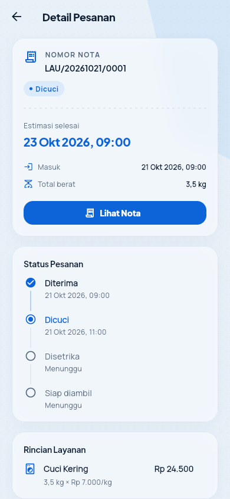
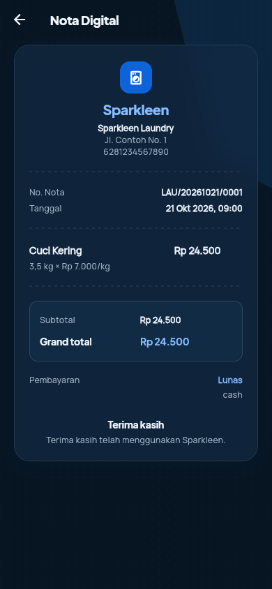

# Sparkleen App

Aplikasi pelanggan Sparkleen Laundry. Dibangun dengan Flutter dan terhubung ke REST API
`/api/v1` milik backend CodeIgniter 4 Sparkleen (repo terpisah).

| Beranda | Detail pesanan | Nota (mode gelap) |
| --- | --- | --- |
|  |  |  |

> Tangkapan layar memakai data demo, bukan data pelanggan sungguhan.

## Fitur

- Masuk dengan nomor telepon + PIN, daftar akun baru, dan aktivasi pelanggan lama lewat nomor nota.
- Beranda: sapaan, pesanan aktif, katalog layanan + harga, poin, dan kontak outlet.
- Riwayat pesanan dengan filter Aktif / Selesai / Semua serta pagination.
- Detail pesanan: timeline status, rincian layanan, pembayaran, dan PIN pengambilan.
- Nota digital yang tidak memuat PIN pengambilan.
- Profil, ubah nama/alamat, dan keluar akun.
- Tema Blue Weave: mode terang dan gelap, kartu kaca, tekstur tenun halus, pemisah
  bergaya struk — tanpa gradasi warna.

## Kebutuhan

- Flutter 3.13.5+ dengan Dart 3.13+.
- Android SDK untuk build APK.
- Backend Sparkleen `/api/v1` yang berjalan.
- Chrome opsional untuk menjalankan target web.

## Menjalankan

```bash
git clone https://github.com/rachmatx/sparkleen-app.git
cd sparkleen-app
flutter pub get
flutter run --dart-define=API_BASE_URL=http://10.0.2.2:8080
```

Pilihan `API_BASE_URL`:

| Target | Nilai |
| --- | --- |
| Emulator Android + backend lokal | `http://10.0.2.2:8080` (default) |
| Device fisik + backend LAN | `http://<IP-LAN-komputer>:8080` |
| Backend produksi | `https://<domain-backend>` |
| Chrome + backend lokal | `http://localhost:8080` (backend harus mengizinkan CORS) |

Tanpa `--dart-define`, aplikasi memakai `http://10.0.2.2:8080`. Untuk device fisik,
pastikan ponsel dan komputer berada di jaringan yang sama. Koneksi HTTP polos ke IP lokal
diizinkan lewat `android/app/src/debug/AndroidManifest.xml`; build release sebaiknya
memakai HTTPS.

### Variasi shell

CMD (Command Prompt):

```bat
set "API_URL=https://<domain-backend>"
flutter run --dart-define=API_BASE_URL=%API_URL%
```

PowerShell:

```powershell
$env:API_URL = "https://<domain-backend>"
flutter run --dart-define=API_BASE_URL=$env:API_URL
```

Git Bash:

```bash
export API_URL="https://<domain-backend>"
flutter run --dart-define=API_BASE_URL="$API_URL"
```

Linux / macOS:

```bash
export API_URL="https://<domain-backend>"
flutter run --dart-define=API_BASE_URL="$API_URL"
```

## Build

APK debug:

```bash
flutter build apk --debug --dart-define=API_BASE_URL=http://10.0.2.2:8080
```

APK release:

```bash
flutter build apk --release --dart-define=API_BASE_URL=https://<domain-backend>
```

Hasil build ada di `build/app/outputs/flutter-apk/`. Konfigurasi signing release masih
memakai debug key bawaan template; buat `android/key.properties` dan konfigurasi keystore
sendiri sebelum distribusi produksi. File tersebut sudah diabaikan Git.

Build web:

```bash
flutter build web --release --dart-define=API_BASE_URL=https://<domain-backend>
```

## Analisis dan test

```bash
flutter analyze
flutter test
```

Saat ini `flutter analyze` bersih dan 40 test lulus.

## Struktur

```
lib/
  core/       tema, api client, secure storage token, router, widget bersama, formatter
  features/
    auth/     login, register, aktivasi, state auth
    home/     beranda, layanan, outlet
    pesanan/  riwayat, detail, timeline
    nota/     nota digital
    profil/   profil dan edit data
    splash/   layar awal
```

## Desain Blue Weave

- Palet solid: royal blue `#0D63D8`, navy `#0A1B30`, pale blue `#DCEBFC`; tanpa gradasi.
- `AppCard` memakai `BackdropFilter` + border tipis untuk efek kaca.
- `AppBackdrop` menggambar tekstur tenun lewat `CustomPainter`, bukan gambar raster.
- `TicketDivider` memberi pemisah bergaya struk laundry.
- Tipografi Plus Jakarta Sans (judul) dan Manrope (isi).
- Warna, radius, dan shadow terpusat di `lib/core/theme/`.

## Keamanan

- Token hanya disimpan di secure storage dan tidak pernah ditulis ke log.
- PIN pengambilan hanya tampil di detail pesanan; payload nota tidak memuat PIN.
- Respons `401` menghapus token dan mengembalikan pengguna ke halaman masuk.
- Nominal pembayaran tidak pernah dikirim dari klien.
- File environment dan keystore diabaikan Git.

## Dokumen

- Spesifikasi: [`docs/superpowers/specs/2026-10-23-sparkleen-mobile-api-design.md`](docs/superpowers/specs/2026-10-23-sparkleen-mobile-api-design.md)
- Plan Flutter fase 1: [`docs/superpowers/plans/2026-10-24-sparkleen-mobile-flutter-phase1.md`](docs/superpowers/plans/2026-10-24-sparkleen-mobile-flutter-phase1.md)
- Plan backend fase 1: [`docs/superpowers/plans/2026-10-23-sparkleen-mobile-api-backend.md`](docs/superpowers/plans/2026-10-23-sparkleen-mobile-api-backend.md)
- Kontrak API: [`docs/api/sparkleen-mobile-v1.md`](docs/api/sparkleen-mobile-v1.md)
- Postman: [`docs/api/sparkleen-mobile-v1.postman_collection.json`](docs/api/sparkleen-mobile-v1.postman_collection.json)

## Status

Fase 1 selesai dan tema Blue Weave sudah diterapkan di seluruh layar. Seluruh layar
utama terhubung ke API, `flutter analyze` bersih, dan `flutter test` hijau (40 test).
