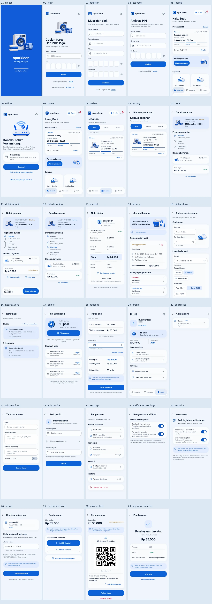
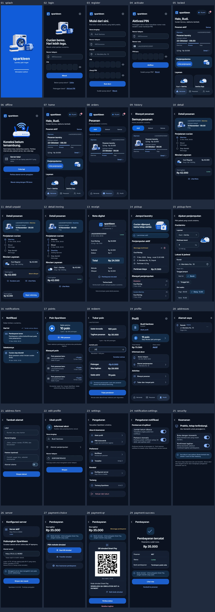

# Sparkleen 0.0.8 — alur UI, portrait, dan navigasi geser

Versi: **0.0.8+8**. Hanya Sparkleen App yang berubah; tidak ada migration atau perubahan Payment API, Smart Pay, maupun Sparkleen Laundry.

## Perubahan

- Android dikunci portrait-up sebelum frame Flutter pertama dan pada activity native. Kompatibilitas Android 16 untuk layar besar diaktifkan. Sistem Android/OEM masih dapat menerapkan pengecualian pada tablet, desktop, atau Android 17+; lihat [ketentuan Android](https://developer.android.com/about/versions/16/behavior-changes-16#adaptive-layouts).
- Navbar kaca 75% dipertahankan. Tinggi area tujuan naik dari 48 menjadi 60 dp (80 dp saat teks besar), inset horizontal dari 16 menjadi 12 dp. Ketuk, geser pada navbar, atau swipe horizontal halaman Beranda/Pesanan/Profil untuk berpindah. Indikator berpindah dengan animasi singkat, mengikuti preferensi kurangi animasi. Scroll vertikal dan state/filter tab tetap terjaga.
- Pesanan aktif tampil sebelum kartu jemput yang lebih ringkas. Sapaan memakai nama depan. Nama layanan menjadi judul pesanan bila tersedia dari API, dengan fallback untuk respons lama.
- “Jadwalkan jemput” membuka formulir. Jika ada permintaan aktif, label menjadi “Lihat penjemputan” dan membuka daftar. Validasi permintaan aktif dari server tetap berlaku.
- Detail belum lunas memiliki bar pembayaran tetap di bawah layar. Total berasal dari detail pesanan; sisa tagihan sebenarnya tetap diperiksa oleh endpoint pembayaran. Nota, PIN pengambilan, dan timeline tetap memakai data pesanan, dengan langkah sesuai layanan.
- Tanggal cepat Hari ini/Besok/kalender serta pilihan slot waktu. Layanan tetap berasal dari API dan estimasi mengikuti pilihan layanan serta berat.
- PIN ditampilkan dalam enam sel dengan satu input terlindungi: keyboard numerik, tempel, hapus, validasi, dan tombol visibilitas tetap tersedia. Login otomatis sekali ketika nomor telepon dan enam digit PIN valid; kegagalan tidak memicu retry berulang. Register dan pembayaran tetap memerlukan konfirmasi eksplisit.
- Layar terkunci memanggil biometrik sekali saat dibuka, dengan tombol retry setelah dibatalkan.
- Pengaturan notifikasi membuka preferensi tersendiri. Badge belum dibaca dan polling 30 detik dapat diatur serta disimpan per perangkat. Ini mengatur notifikasi di aplikasi, bukan menambahkan push notification latar belakang.
- QR simulasi menampilkan countdown dari expired_at; waktu habis tidak otomatis mengubah status transaksi. Penukaran poin menambahkan tombol minus/plus dan “Gunakan semua”, dengan batas dan konfirmasi server tetap berlaku.
- Nomor telepon dirapikan untuk tampilan; dialog hapus, batalkan, dan keluar memakai warna danger. Status tetap berupa teks berwarna tanpa dot atau latar badge.

## Verifikasi

- Flutter analyzer: tanpa temuan.
- **198 tes lolos**, termasuk swipe/navbar/portrait, state tab, pemisahan preferensi notifikasi, polling, alur jemput, bar bayar, dan retry biometrik.
- Render aktual **29 layar/state × 2 tema**, termasuk scrolling konten panjang; layout diuji pada lebar 320–412 px dan skala teks sampai 200%.
- Build release flavor preview berhasil, satu ABI ARM64, simbol terpisah; APK memakai versi 0.0.8, minSdk 24, targetSdk 36.
- Signature APK dan ZIP alignment 16 KiB diverifikasi. Assets WebP dan font lokal tetap dibundel.
- SHA-256 APK: `85772d77c9ae7df7ffb52c3d435875aaf5a8ef9286eabd96cf20d576be6309e7`.
- Belum diuji pada smartphone fisik dalam lingkungan ini. Uji sensor biometrik, rotasi perangkat, koneksi server lokal, serta alur pembayaran simulasi pada HP tetap diperlukan.

## Instalasi dan penandatanganan

APK preview ditandatangani dengan sertifikat debug baru pada build ini. Jika Android menolak update karena sertifikat berbeda, catat server yang digunakan, hapus aplikasi preview lama, lalu instal APK baru. Penghapusan aplikasi menghapus sesi, preferensi, dan konfigurasi server lokal perangkat; data pesanan dan alamat yang tersimpan di backend tidak ikut terhapus.

Preview ini bukan rilis produksi. Kunci produksi harus dikelola pemilik proyek. Token GitHub tidak disimpan di source, remote, atau konfigurasi Git.

## Build di komputer sendiri

```sh
flutter pub get
flutter test --dart-define=APP_PREVIEW=true
flutter build apk --release --flavor preview --dart-define=APP_PREVIEW=true --target-platform=android-arm64 --split-per-abi --split-debug-info=build/symbols/0.0.8
```

Hasil: `build/app/outputs/flutter-apk/app-arm64-v8a-preview-release.apk`.

## Hasil render



